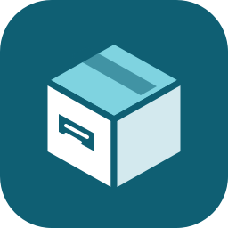

<p align="center">
  
</p>

# SIMANIS — Sistem Informasi Manajemen Inventaris

**SIMANIS** (singkatan dari **Sistem Informasi Manajemen Inventaris**) adalah aplikasi web untuk mengelola aset inventaris di banyak gedung. Aplikasi ini mencatat **di mana setiap aset berada** (gedung → lantai → ruangan), **bagaimana kondisinya**, dan **semua yang pernah terjadi padanya**: perpindahan, peminjaman, servis, stock opname, sampai penghapusan.

---

## Fitur

### Data master
- **Gedung, lantai, ruangan** — hierarki lokasi bertingkat. Setiap aset tercatat di satu ruangan.
- **Kategori** — kode kategori dipakai di nomor seri aset, sekaligus menyimpan umur ekonomis dan persentase nilai sisa untuk penyusutan.
- **Aset**
  - Nomor seri dibuat otomatis: `<ruangan><kode kategori><yy><mm><nomor urut>`. Input jumlah > 1 membuat banyak aset sekaligus.
  - Import massal dari CSV / XLS (contoh format di `csv_file/base_import_format.csv`).
  - Data pembelian: tanggal perolehan, harga, vendor, masa garansi.
  - Kondisi aset (Baik / Rusak Ringan / Rusak Berat) beserta log setiap perubahannya.
  - Foto aset: banyak foto per aset, foto utama, thumbnail otomatis. Gambar di-encode ulang dan metadata EXIF/GPS dibuang.
- **Pengguna** — admin dan user gedung (satu akun per gedung), dengan foto profil dan email untuk notifikasi.

### Halaman detail aset
Satu halaman yang memuat semua informasi aset: foto, status (lokasi, kondisi, dipinjam, diajukan hapus), QR code, tombol aksi cepat, dan tab Ringkasan, Riwayat, Foto, Maintenance, serta Peminjaman. Tab **Riwayat** menampilkan timeline gabungan semua kejadian pada aset, mulai dari pendaftaran sampai penghapusan.

### QR code & halaman scan
- Cetak label QR per ruangan atau per pilihan aset (A4, 3 × 7 label).
- Scan QR dari HP membuka halaman publik berisi identitas dan lokasi aset. Riwayat dan aksi (ubah kondisi, catat servis, pinjamkan, unggah foto) hanya muncul untuk pengguna yang berhak.
- Alamat QR bisa diarahkan ke IP LAN (`qr_base_url`) supaya bisa dibuka dari HP.

### Transaksi perpindahan aset
- **Pindahkan aset**, satuan maupun massal. Setiap pemindahan menghasilkan transaksi bernomor `TRX/AST/YYYY/MM/000001`.
- **Transaksi Keluar** — daftar kiriman dari gedung asal yang belum diterima.
- **Transaksi Masuk** — gedung tujuan menerima atau menolak kiriman per aset. Lokasi aset baru berubah setelah kiriman diterima.
- **Notifikasi** — email ke pengguna di gedung tujuan saat ada kiriman, ditambah badge di sidebar dan lonceng di topbar.
- **Riwayat transaksi** dan cetak **BAST** (Berita Acara Serah Terima) dalam format PDF.

### Peminjaman aset
Pinjamkan aset ke pihak mana saja (nama, unit, kontak, keperluan, jatuh tempo). Sistem menangani pengembalian beserta kondisinya, perpanjangan, penanda terlambat, cetak slip pinjam (PDF A5), dan pengingat email. Aset yang sedang dipinjam tidak bisa dipindah, dipinjam ulang, atau diajukan hapus.

### Stock opname
Buka sesi opname per ruangan, lalu centang aset yang ditemukan lewat scan QR atau input nomor seri. Sistem mendeteksi aset yang berada di ruangan yang salah, mencatat kondisi dan foto saat pemeriksaan, lalu menghasilkan berita acara opname dalam PDF.

### Maintenance
- Jadwal servis berkala per aset (interval hari / minggu / bulan / tahun) dengan status jatuh tempo, segera, dan terlewat.
- Catat servis rutin maupun perbaikan insidental, lengkap dengan biaya, vendor, dan kondisi setelah servis.
- Riwayat maintenance yang bisa diekspor ke Excel, plus pengingat email sebelum jatuh tempo.

### Penghapusan (disposal) aset
Aset berkondisi Rusak Berat bisa diajukan untuk dihapus dengan metode musnah, jual, hibah, atau lainnya. Admin menyetujui atau menolak pengajuan, lalu sistem mencetak BAST penghapusan. Data aset tidak dihapus fisik, sehingga riwayatnya tetap utuh.

### Laporan & dashboard
- **Dashboard** — ringkasan jumlah aset, grafik transaksi 12 bulan terakhir, kondisi aset per lokasi, aset per kategori, dan transaksi terbaru.
- **Rekap Aset** — dikelompokkan per gedung, ruangan, kategori, atau kondisi, dengan filter status aktif/dihapus. Bisa diekspor ke Excel dan PDF.
- **Nilai Aset** — nilai buku dan akumulasi penyusutan (metode garis lurus) per tanggal acuan, dalam bentuk ringkasan per kategori dan detail per aset. Bisa diekspor ke Excel dan PDF.

### Keamanan & audit
- Login dengan password ter-hash, lupa password via email, dan ganti password.
- Hak akses berbasis peran: **Admin** melihat dan mengelola semua gedung, **User** dibatasi pada gedungnya sendiri.
- ID di URL dienkripsi.
- **Audit log** — setiap perubahan data, ekspor, dan cetak laporan tercatat (siapa, kapan, apa yang berubah, IP). Tersedia filter, ekspor Excel, dan retensi otomatis.
- Aset yang sudah punya riwayat resmi tidak bisa dihapus permanen.

---

## Spesifikasi teknis

| Bagian | Teknologi |
|---|---|
| Bahasa | PHP 8.3 |
| Framework | CodeIgniter 3.1.13 (core di-patch `#[\AllowDynamicProperties]` untuk PHP 8.2+) |
| Database | MySQL / MariaDB (driver `mysqli`) |
| UI | SB Admin 2 (Bootstrap 4, jQuery), DataTables, Select2, SweetAlert2, Chart.js |
| Library | `phpoffice/phpspreadsheet` (import/ekspor Excel), `dompdf/dompdf` (PDF), `chillerlan/php-qrcode` (QR code) |
| Ekstensi PHP | `mysqli`, `gd`, `mbstring`, `zip`, `xml`, `openssl` |
| Web server | Apache dengan `mod_rewrite` (dikembangkan di Laragon) |

### Struktur folder

```
application/
  controllers/   modul aplikasi (Asset, Transaction, TI, TO, Loan, Opname, Maintenance,
                 Disposal, Report, Valuation, Activity, Scan, Cron, ...)
  models/        query per modul (<Nama>_model.php)
  helpers/       auth guard, menu, kode transaksi, kondisi, penyusutan, maintenance, peminjaman
  libraries/     Pdf, Qr, Audit, Asset_image, Transaction_notifier
  views/         view per modul + templates/ (header, sidebar, topbar, footer)
assets/          CSS, JS, gambar
DATABASE/        dump database dan migrasi SQL bernomor (001–012)
csv_file/        contoh format import aset
uploads/         foto aset dan foto profil
```

---

## Instalasi

1. **Clone** repo ke folder web server, misalnya `C:\laragon\www\asset-management`.
2. **Install dependency**
   ```bash
   composer install
   ```
3. **Siapkan database**
   - Buat database `simanis`.
   - Import dump `DATABASE/bnb_asset-15-04-2024.sql`.
   - Jalankan migrasi `DATABASE/001-*.sql` sampai `012-*.sql` secara berurutan.
   - Opsional: `DATABASE/seed-demo-purchase-data.sql` untuk data pembelian contoh.
4. **Konfigurasi** di `application/config/`:
   - `config.php`: `base_url`, `encryption_key`, `qr_base_url` (kosong = pakai `base_url`), `maintenance_mail_from`, `notification_mail_from`, `transaction_mail_instant`, `audit_retention_days`.
   - `database.php`: kredensial MySQL.
   - `email.php`: salin dari `email.example.php` lalu isi SMTP. File ini tidak di-commit.
5. Buka aplikasi di browser, misalnya `http://asset-management.test/`.

### Tugas terjadwal (cron)

Pengingat dan pembersihan dijalankan lewat CLI:

```bash
php index.php cron daily                      # semua tugas harian sekaligus
php index.php cron maintenance_reminders      # pengingat jadwal servis
php index.php cron loan_reminders             # pengingat peminjaman jatuh tempo
php index.php cron transaction_notifications  # kirim ulang notifikasi kiriman yang gagal
php index.php cron audit_cleanup              # hapus audit log sesuai retensi
```

Tambahkan argumen `dry` untuk mencoba tanpa mengirim email atau menghapus data. Di Windows, jadwalkan lewat Task Scheduler; di Linux, lewat crontab.

---

## Lisensi

Framework CodeIgniter dirilis di bawah lisensi MIT (lihat `license.txt`).
